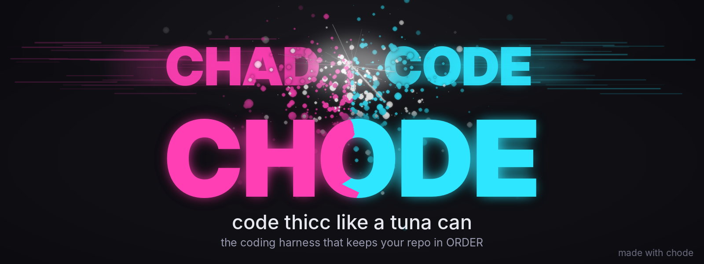

<p align="center">
  
</p>

<p align="center">
  <a href="https://github.com/chchchadzilla/chode/releases/latest"></a>
  
  <a href="LICENSE"></a>
  
  
  
  
</p>

<h1 align="center">CHODE</h1>
<p align="center"><b>code thicc like a tuna can.</b><br>
The coding harness that works with <i>any</i> AI, rides the subscription you already pay for, imports your gear from every other coding agent in one click, remembers you between sessions, and keeps every repo in ORDER without being asked.</p>

<p align="center"><i>c'mon, don't be a chode. you can do this.</i></p>

---

## What is this?

CHODE is a program you run in your terminal (or in your browser, if terminals scare you — there's a GUI). You type what you want in plain English. It reads your project, writes the code, runs the tests, fixes what broke, writes the docs, commits, and pushes. You watch, approve, and steer.

It's for **people who have never coded** ("make me a website for my bakery") and for **people who code all day** ("refactor the auth module to use the new session store and add tests"). Same tool. Same brain. It just explains more when you need it to.

Three things make it different from every other coding agent:

1. **It's not married to one AI company.** Claude, GPT, Gemini, Grok, DeepSeek, Kimi, Llama — or a free model running on your own laptop. And if you already pay for Claude Max / ChatGPT Pro / Google AI Ultra, CHODE rides that plan. No API key, no second bill.
2. **Zero friction switching.** `chode import` pulls your rules, skills, slash commands, agents, MCP servers, permissions and hooks out of Claude Code, Codex, Cursor, VS Code, Antigravity, Gemini CLI, Windsurf, Cline, Roo, Continue, Copilot, OpenCode, Zed, Kiro, Aider… one command, one confirm. Nothing gets deleted from the other tools.
3. **It keeps you in ORDER.** Every repo gets a real README, an `ABOUT.md` with the story *and* ready-to-post marketing copy, a LICENSE, CHANGELOG, tests, CI, backups, and clean commits — automatically. Because thicc only counts if it's tidy.

---

## 60-second start (no coding required)

### 1. Get Python (skip if you have it)

| you're on | do this |
|---|---|
| **Windows** | Go to [python.org/downloads](https://www.python.org/downloads/), click the big yellow button, run it, and **tick the box that says "Add python.exe to PATH"**. That box matters. |
| **Mac** | Open *Terminal* (press ⌘-space, type `terminal`). Paste: `python3 --version`. If it says a version, you're done. If not: `xcode-select --install` or `brew install python3`. |
| **Linux** | You almost certainly have it. If not: `sudo apt install python3 python3-pip` (Debian/Ubuntu) or your distro's equivalent. |

### 2. Install CHODE

Pick ONE. Paste it into your terminal (PowerShell on Windows) and press Enter.

```bash
# the one-liner (mac / linux)
curl -fsSL https://raw.githubusercontent.com/chchchadzilla/chode/main/install.sh | sh
```
```powershell
# the one-liner (windows powershell)
irm https://raw.githubusercontent.com/chchchadzilla/chode/main/install.ps1 | iex
```
```bash
# or with pipx / pip (any OS)
pipx install git+https://github.com/chchchadzilla/chode
#   — or —
pip install --user git+https://github.com/chchchadzilla/chode
```
```bash
# or straight from a clone, no install at all
git clone https://github.com/chchchadzilla/chode.git && cd chode
./chode-start            # mac / linux
chode-start.bat          # windows
```

> **"It says `chode` is not recognized."** Try `python -m chode` (or `python3 -m chode`). Same thing, longer name.

### 3. Run it

```bash
chode
```

You'll see CHAD and CODE smash into each other (that's the intro — it's fine, it's supposed to do that) and a menu. Pick **Setup**. It asks you four questions:

1. **What should I call you?** — your name. Or "legend". Your call.
2. **How should CHODE think?** — this is the only one that matters:
   - **Subscription I already pay for** → you have Claude Pro/Max, ChatGPT Plus/Pro, or Google AI Pro/Ultra. Pick it. No key needed.
   - **API key** → you have (or will get) a key from Anthropic / OpenAI / Google / xAI / DeepSeek / OpenRouter. Paste it. It's stored on your machine only.
   - **Local & free** → you installed [Ollama](https://ollama.com) or LM Studio. Nothing leaves your computer. Costs $0.
3. **Permission mode** — `ask` is the default: CHODE asks before it changes a file or runs a command. Keep `ask` until you trust it.
4. **The ORDER stuff** — daily backups? remember things between sessions? auto-commit? (yes, yes, your call)

Then pick **Import** if you've used Claude Code / Cursor / Codex / VS Code before. Everything you set up there comes along.

### 4. Say something

```
you › make me a tiny website that shows the time in big friendly letters
```

That's it. That's the whole tutorial. CHODE will make a folder, write the files, open it if it can, and tell you what it did in words you can read. Ask it to change the colors. Ask it why it did something. Ask it to put the project on GitHub (`/ship`). You're coding now.

---

## It always works (the lifeline)

No API key? Wrong model name? Provider down? Out of free credits? CHODE does not show you a stack trace and quit.

- **Zero-key start.** `chode setup` → *"Just make it work (free)"* picks whatever can answer on your machine right now: a local Ollama model if you have one, else a free keyless model. *"Free key, 2 minutes"* opens Gemini/Groq/OpenRouter/Mistral's key page for you and only asks you to paste it.
- **Retries that make sense.** Network blips, rate limits and server errors get backoff and `Retry-After`; bad keys and unknown models don't waste your time retrying.
- **Model names fix themselves.** Typed `anthropic/opus-5.5`, `Opus 5.5` or `gpt5 mini`? CHODE normalizes what humans type into what the API wants (`claude-opus-5-5`, `gpt-5-mini`), then checks it against the provider's **live model list** the moment you set it (`/model`, `/provider`, the wizard, `chode --model`) and tells you what it changed. Typos resolve to the closest real id; `sonnet` / `opus` / `haiku` always mean "the newest you have".
- **Settings a model won't take get dropped, not fatal.** Claude 4.7+/5.x reject `temperature`; OpenAI's reasoning models reject it too; OpenRouter and Ollama models happily take `temperature`/`top_p`/`top_k`. CHODE knows the known cases, learns the rest live from the 400, retries without the setting, and **remembers it per model**. `/sampling` shows exactly what's sent to the current model and lets you set temperature / top_p / top_k globally, per provider, or per model.
- **A fallback ladder.** When a provider is truly dead for the session, CHODE walks: your other keys → local servers that are actually running → a free keyless model. It tells you every switch and never changes your saved default unless you say `/provider keep`.
- **Every error comes with the whole answer.** Not a tip. A block that says *what happened* in plain English, *what CHODE already did*, *do this now* (specific to the error: the exact keys page and env var for a bad key, the corrected name for a wrong model, the setting to flip for a rejected parameter, the command to start Ollama), *three free ways to be coding in two minutes*, and the one command that does it for you.
- **`chode fix`** — the connection doctor. A tiny agent runs on whatever model *does* answer, lists models, reads the provider docs, switches provider or model, tests, and tells you in three lines what it changed. It can set provider/model/URLs/sampling; it can never see or set API keys.

Details: [docs/lifeline.md](docs/lifeline.md).

## What makes it thicc

| | feature | what it means for you |
|---|---|---|
| 🪢 | **Lifeline** | Retries, error hints, model-name auto-correction, a fallback ladder that ends in a free model, and `chode fix` to repair the config for you. You are never stuck at "can't connect". |
| 💳 | **Plan Bridge** | Use your Claude Max / ChatGPT Pro / Gemini Ultra subscription as CHODE's brain. CHODE drives the official CLI and mounts *itself* as an MCP server, so the vendor's model thinks on your plan and acts through CHODE's tools, memory and safety rails. `chode ride claude` does the reverse: their TUI, with CHODE's gear inside. |
| 🥤 | **The Gulp** (`chode import`) | One-click import from 20+ coding agents: rules → memory, SKILL.md → skills, commands/prompts → slash commands, agents → sub-agent personas, mcpServers → MCP, permissions → allow/deny lists, hooks → hooks (Claude Code's hook format just works). |
| 📐 | **ORDER** | **O**rganize · **R**ecord · **D**ocument · **E**xport · **R**elease. Audits every repo for README / ABOUT.md / LICENSE / CHANGELOG / tests / CI / secrets / tidiness, scores it 0–100 ("flat" → "tuna can"), scaffolds the boring parts, and has the model write the parts that need taste — including `ABOUT.md` with the origin story, marketing copy, 3 tweets, a LinkedIn post, a Reddit post and a Show HN line. |
| 🧠 | **Persistent memory** | Reads `CHODE.md` / `AGENTS.md` / `CLAUDE.md` / `GEMINI.md` / `.cursorrules` natively. Keeps an episodic memory of facts, decisions, preferences and lessons per project and globally; recalls the relevant ones into every session; reflects at the end of a session on what's worth keeping. `/remember`, `/memories`, `/forget`. |
| 🪞 | **Conscience + ledger** | A living `CONSCIENCE.md` the agent honors and updates with lessons from real incidents. Every risky moment (dangerous command, denial, undo, redaction, out-of-tree write, prompt-injection attempt) goes in a ledger you can read with `/ledger`. Accountability without a nanny. |
| 🔎 | **Local RAG** | A stdlib BM25 index of your codebase (optional embeddings), auto-built, so the model reads *only* what matters. Fewer tokens, fewer dollars, better answers. `/search`, `/index`. |
| 🚀 | **Ship & release** | `/ship`: stage → scan for secrets (refuses to commit keys) → model-written conventional commit → push → create the GitHub repo if there isn't one. `/release v1.2.3`: bump versions, changelog, tag, push, GitHub release. Hugging Face uploads too. Optional auto-commit after every change. |
| 🖥 | **The Deck** | A zero-dependency browser GUI (`chode gui`): streaming chat, tool calls, diff previews, permission buttons, ORDER score, todos and memory in a sidebar. Bound to localhost with a secret token. |
| 🎨 | **Banners** | `chode banner` makes a banner.png/.svg and icon for any repo in the house style (two words collide, dust, result). Uses a real image model if you have a key; otherwise the built-in generator. The one at the top of this page came out of it. |
| 🪝 | **Hooks, skills, agents, MCP** | Lifecycle hooks (pre/post tool, prompt, session). Portable `SKILL.md` skills. Named sub-agent personas. MCP over stdio *and* HTTP. Sub-agents for parallel/heavy subtasks. |
| ⚡ | **A better terminal** | Streaming output with live markdown styling, a status line (model · mode · context % · cost), tab completion for `/commands` and `@files`, `/diff`, `/git`, `/undo`, `/cost`, themes, and the collision intro. |
| 🛡 | **Safety that isn't restrictive** | Four modes (`plan` read-only · `ask` · `edits` · `yolo`). Dangerous commands always need a typed `yes`. Deny lists. Secrets redacted before anything hits a model and blocked from commits. Cloud-metadata SSRF guard. Prompt-injection detection on fetched pages. Config file `chmod 600`. |

---

## Talking to CHODE

Just type. Some things that work:

```
you › explain this project to me like I'm new here
you › add a dark mode toggle to the settings page and write a test for it
you › why is the login test failing?  fix it
you › put this repo in order and ship it
you › @src/auth.py what does this file do?
you › !pytest -q                      ← runs it yourself; output becomes context
you › #we deploy from the release branch, never main    ← saved to CHODE.md
```

### Slash commands (the greatest hits)

| command | does |
|---|---|
| `/help` | all of them |
| `/mode plan\|ask\|edits\|yolo` | how much CHODE may do without asking |
| `/model`, `/models`, `/provider` | switch brains mid-conversation (names are normalized and checked against the live list) |
| `/sampling [edit]` | see what's sent to this model; set temperature / top_p / top_k globally, per provider or per model |
| `/order` · `/about` · `/status` · `/tidy` · `/backup` | ORDER |
| `/ship [message]` · `/release v1.2.3` · `/banner` | publish |
| `/remember <text>` · `/memories` · `/forget <id>` · `/memory` · `/init` | memory |
| `/conscience` · `/ledger` | the mindful bits |
| `/search <q>` · `/index` | local RAG |
| `/import [folder…] [--drives]` · `/plans` · `/ride claude\|codex\|gemini` | friction removal |
| `/fix` · `/lifeline` · `/provider keep` | repair the model connection · see the fallback ladder · keep a fallback as default |
| `/gui` | open the Deck |
| `/undo` · `/diff` · `/git` · `/cost` · `/compact` · `/resume` · `/export` | session |
| `/skills` · `/agents` · `/mcp` · `/hooks` · `/permissions` · `/config` | gear |

Every markdown file in `~/.chode/commands/` (or `.chode/commands/`, or `.claude/commands/`) becomes a `/command`. `$ARGUMENTS` is replaced with whatever you type after it.

### CLI

```
chode                      menu            chode setup             wizard
chode -p "fix the tests"   one-shot        chode "fix the tests"   same thing
chode -c                   continue        chode gui               the Deck
chode import [--drives]    the gulp        chode plans             detect subscriptions
chode import D:\\old ~/usb  import from any folder / drive         chode sampling [edit]   temperature · top_p · top_k
chode ride claude          handoff         chode order [fix]       audit / scaffold
chode backup [list|restore N]              chode index · chode search <q>
chode ship [msg] · chode release vX.Y.Z    chode banner [name]
chode doctor · chode health                chode mcp-serve         CHODE as an MCP server
chode fix                  connection doctor      chode lifeline          what can answer here
chode skills · chode memory · chode ledger · chode conscience
```

---

## Providers

| provider | what you need | notes |
|---|---|---|
| `claude-plan` | the `claude` CLI, logged in | Claude Pro / Max — no key |
| `codex-plan` | the `codex` CLI, logged in | ChatGPT Plus / Pro — no key |
| `gemini-plan` | the `gemini` CLI, logged in | Google AI Pro / Ultra — no key |
| `custom-plan` | any CLI | set `plans.custom.command` |
| `anthropic` | `ANTHROPIC_API_KEY` | Claude models (aliases: `opus`, `sonnet`, `haiku`, `fable`) |
| `openai` | `OPENAI_API_KEY` | GPT models |
| `gemini` | `GEMINI_API_KEY` | Google Gemini |
| `xai` | `XAI_API_KEY` | Grok |
| `openrouter` | `OPENROUTER_API_KEY` | hundreds of models, some **free** |
| `groq`, `mistral`, `cerebras`, `huggingface` | a **free-tier** key (2-minute signup, no card) | fast / cheap; the wizard opens the signup page |
| `deepseek`, `together`, `moonshot`, `perplexity`, `azure` | their key | cheap / specialized |
| `ollama`, `lmstudio`, `local` | nothing | **free, offline**, any OpenAI-compatible server |
| `pollinations` | nothing — no key, no signup | **free**, community-run, rate-limited; the last rung of the lifeline |

Switch any time: `/provider openrouter qwen/qwen3-coder:free`. See what can answer on your machine: `chode lifeline`.

> Grok: xAI doesn't ship an agent CLI with subscription login yet, so Grok rides on an API key (`xai`). The moment one exists, point `plans.custom.command` at it.

---

## The Plan Bridge, honestly

You already pay for a frontier model. CHODE should not make you pay twice. So:

```
chode setup  →  "Subscription I already pay for"  →  claude-plan
```

Under the hood CHODE runs `claude -p … --output-format json --tools "" --mcp-config <chode>` with itself registered as the only MCP server. The model is Anthropic's, on your plan; the hands are CHODE's: its permission lanes, memory, ORDER, ledger. Codex and Gemini work the same way (`codex exec --json`, `gemini -p --output-format json`). Everything is a template in `config.json → plans.*` so if a vendor changes a flag tomorrow, you fix one line, not the program.

What you give up in bridge mode: interactive permission prompts inside the vendor process (they can't ask you; CHODE's MCP server asks on your terminal when one is attached, otherwise it refuses anything the mode doesn't allow). What you keep: everything else.

Prefer their TUI? `chode ride claude` opens Claude Code with CHODE's tools and memory mounted. `chode ride codex`, `chode ride gemini` likewise.

---

## The Gulp (import)

```
chode import
```

CHODE scans the places other agents keep their stuff and shows you a numbered list. Pick `all`, `new`, or `1,3-5`.

Your stuff lives somewhere else? **Other drives:** `chode import --drives` (or say yes when it asks) looks on every other
mounted drive (`D:`, `E:`, `/Volumes/*`, `/media/*`, `/mnt/*`, WSL's `/mnt/c`) for agent folders (`.claude`, `.codex`, `.cursor`…
under any `Users/<name>`) and loose folders of `SKILL.md` skills. It's bounded (a few seconds per drive, never inside `Windows/`,
`Program Files/`, `node_modules/`…). **Any folder:** `chode import D:\old-laptop ~/usb/my-skills` takes a single skill, a
skills folder, a copied `~/.claude`, or a project. Inside a session: `/import --drives`, `/import <folder>`.

| from | what it finds | becomes |
|---|---|---|
| Claude Code | `CLAUDE.md`, `~/.claude/skills`, `commands`, `agents`, `settings.json` (permissions, hooks), `~/.claude.json` / `.mcp.json` (MCP) | memory, skills, commands, agent personas, allow/deny lists, hooks, MCP |
| Codex | `~/.codex/config.toml` (MCP, model), `AGENTS.md`, `prompts/`, `skills/` | MCP, memory, commands, skills |
| Gemini CLI / Antigravity | `GEMINI.md`, `~/.gemini/settings.json`, `.gemini/commands/*.toml`, `.agent/rules`, `.agent/workflows`, `mcp_config.json` | memory, MCP, commands |
| Cursor | `.cursorrules`, `.cursor/rules/*.mdc`, `mcp.json` | memory, MCP |
| VS Code (+ Insiders, Cursor, Windsurf, Antigravity, VSCodium) | `mcp.json`, Copilot `codeGeneration.instructions`, installed AI extensions | MCP, memory, a report of what CHODE replaces |
| Windsurf · Cline · Roo · Kilo | rules files, `mcp_settings.json` | memory, MCP |
| Copilot | `.github/copilot-instructions.md`, `instructions/`, `prompts/`, `agents/` | memory, commands, agents |
| Continue · OpenCode · Zed · Kiro · Amp · Junie · Aider · OpenClaw · Hermes | their config / rules / skills | the matching thing |

Secrets found inside rule files are stripped before they're stored. Nothing is removed from the source tools.

---

## ORDER

```
you › put this repo in order
```

or `chode order fix`. CHODE:

1. **Audits** — 17 checks, weighted, scored 0–100 with a label (`flat` → `skipping leg day` → `getting there` → `thicc` → `tuna can 🥫`). Includes "no secrets in tracked files" and "no 25 MB+ files".
2. **Scaffolds the deterministic parts** — `.gitignore` for your language(s), MIT `LICENSE` (your name from git), `CHANGELOG.md`, `docs/`, CI workflow, `CONTRIBUTING.md`, `SECURITY.md`, `git init` if needed. Never overwrites a file that has content.
3. **Hands the rest to the model** via the built-in `repo-order` skill — `README.md` a beginner can follow, `ABOUT.md` (story · who it's for · one-liner / 50 / 150-word blurbs · 3 X posts · LinkedIn · Reddit · Show HN · hashtags · "explain it to your mom"), a smoke test if there are none.
4. **Backs up** — `~/.chode/backups/<project>/*.tar.gz`, rotated, daily by default, size-guarded. `/backup restore 1` never overwrites your working tree.
5. **Tidies** — points at stray logs, archives, loose scripts, empty dirs, duplicate READMEs. Suggests; doesn't move things behind your back.

The ORDER score shows up at the start of every session. `/status` any time.

---

## Memory

Three layers, all plain files you can open and edit:

- **Instruction files** — `CHODE.md`, `AGENTS.md`, `CLAUDE.md`, `GEMINI.md`, `.cursorrules`, `CONVENTIONS.md`, `.github/copilot-instructions.md`… found in your project (walking up to the repo root) plus `~/.chode/CHODE.md`. Read natively. `#note` appends to the project file.
- **Episodic memory** — `~/.chode/memory/<project>.jsonl` + `global.jsonl`. Facts, preferences, decisions, lessons, todos. Added by you (`/remember`), by the model (`remember` tool), or by the end-of-session reflection ("what's worth keeping?"). Recalled by relevance into each session.
- **Sessions** — `~/.chode/sessions/`, `/resume` or `chode -c`.

```
you › /remember we use pnpm, never npm --global
you › /memories
```

---

## Safety, the honest version

CHODE's stance is written in `~/.chode/CONSCIENCE.md`. Short version: *do what you ask; say the worry once, before, briefly; reversible → do it; destructive → ask; never hide what happened.* The agent reads it every session and appends a dated lesson when a session had real incidents.

Mechanically:

- **Modes:** `plan` (read-only), `ask` (default: every write/command asks, with a diff preview), `edits` (files auto-approved, shell asks), `yolo` (everything auto-approved **except** dangerous commands).
- **Dangerous-command guard:** `rm -rf /`, `sudo`, force-push, `git reset --hard`, `curl | sh`, disk/registry/shadow-copy wipes, `npm publish`, `DROP TABLE`, cloud `delete`… ~40 patterns, POSIX and PowerShell. Always needs a typed `yes`, in every mode.
- **Allow/deny lists:** `bash_allow` prefixes auto-approve (**every** segment of a chained command must match — `git status && rm -rf /` doesn't sneak through). `bash_deny` is a hard no. Project-level `.chode/permissions.json` too.
- **Secrets:** API keys, tokens, JWTs, private keys are redacted before tool output reaches a model; `/ship` refuses to commit them; reads of `.env`/`.ssh`/… warn.
- **Web:** cloud-metadata endpoints are never fetched; fetched content is wrapped as untrusted data and scanned for prompt-injection phrases (logged if found).
- **Ledger:** `/ledger` lists every risky moment with a timestamp. `/undo` reverts the last file change (stacked).
- **Local-only:** config is `chmod 600`, the GUI binds `127.0.0.1` behind a random token, nothing phones home.

---

## Configuration

`~/.chode/config.json` (made by `chode setup`; edit with `/config key value` or any editor). Project overrides in `./.chode/config.json`, MCP in `./.chode/mcp.json`, permissions in `./.chode/permissions.json`, hooks in `./.chode/hooks.json`. Full reference: [docs/configuration.md](docs/configuration.md).

```json
{
  "provider": "claude-plan",
  "mode": "ask",
  "bash_allow": ["git status", "git diff", "pytest", "npm test"],
  "memory": {"auto_reflect": true},
  "order": {"auto_backup_hours": 24, "backup_keep": 10},
  "publish": {"autocommit": "off", "huggingface_repo": ""},
  "rag": {"embeddings": false},
  "hooks": {"pre_tool": [{"match": "bash", "command": "python scripts/check.py"}]}
}
```

---

## Troubleshooting (a.k.a. things that happen to everyone)

| it says | do |
|---|---|
| `python: command not found` / `not recognized` | Install Python (step 1). On Windows, re-run the installer and tick "Add python.exe to PATH". Close and reopen the terminal. |
| `chode: command not found` | `python -m chode`. Or add `~/.local/bin` (mac/linux) / `%APPDATA%\Python\Scripts` (windows) to your PATH. |
| `no API key for anthropic` | `chode setup` → *Just make it work (free)*, or paste a key, or choose local. CHODE also falls back on its own at startup. |
| `the model didn't answer — [not_found] …` | CHODE auto-corrects model names when it can; otherwise `/models` then `/model <name>`, or just `/fix`. Vendor ids are odd: Anthropic's is `claude-opus-5-5`, not `anthropic/opus-5.5` — type whatever, CHODE normalizes it and checks the live list. |
| `` `temperature` is deprecated for this model `` (HTTP 400) | Claude 4.7+/5.x don't take sampling settings. CHODE drops it, retries and remembers that for the model — just try again. `/sampling` shows what's sent; models that *do* take it (OpenRouter, Ollama…) still get it. |
| it keeps saying `rate_limit` | you're out of free quota on that provider. `/lifeline` shows what else can answer; `/fix` switches for you. |
| any connection failure | you get a full "what happened / what CHODE did / do this now / free ways out" block, specific to the error. Follow step 1. Or `chode fix`. |
| my skills are on another drive | `chode import --drives`, or `chode import <that folder>`. |
| `claude CLI not found` | `npm i -g @anthropic-ai/claude-code && claude login` (Codex: `npm i -g @openai/codex`; Gemini: `npm i -g @google/gemini-cli`). |
| `Could not connect to http://localhost:11434` | Start Ollama (`ollama serve`) and pull a model (`ollama pull qwen3-coder`). |
| the intro animation looks broken | your terminal is under 76 columns or doesn't do ANSI; `chode --no-intro` or `/config intro false`. |
| it keeps asking permission | that's `ask` mode doing its job. Press `a` to always-allow that tool for the session, `p` to allow that command prefix forever, or `/mode edits`. |
| it did something wrong | `/undo`. Then `/ledger` to see what happened. Then tell it. |
| everything else | `chode doctor` — it checks Python, keys, endpoints, CLIs, MCP servers, skills, permissions, disk. |

---

## Development

```bash
git clone https://github.com/chchchadzilla/chode.git && cd chode
pip install -e ".[dev]"
pytest -q                       # ~60 tests, runs offline (scripted mock LLM + mock MCP server)
python scripts/make_brand.py    # regenerate assets/
python -m build                 # wheel + sdist in dist/ (attach these to a release)
```

Tests are the gate, and they run on your machine in seconds. The GitHub Actions workflows in `.github/workflows/` are **opt-in** (started from the Actions tab) so no minutes are spent and no red X's appear unless you want them. CHODE itself works with any git host: `/ship` pushes to whatever `origin` is (GitHub, GitLab, Codeberg, Gitea…); only "create the repo for me" and "create the release for me" are GitHub-specific conveniences.

Layout: `chode/` is the package (one module per concern: `agent`, `tools`, `permissions`, `memory`, `conscience`, `order`, `publish`, `rag`, `importer`, `plans`, `mcp`, `mcp_server`, `gui`, `banner`, `hooks`, `skills`, `llm`, `ui`, `repl`, `commands`, `cli`…). `tests/` mirrors it. `CHODE.md` is the project memory for CHODE itself (yes, it dogfoods).

See [CONTRIBUTING.md](CONTRIBUTING.md), [SECURITY.md](SECURITY.md), [CHANGELOG.md](CHANGELOG.md), [ABOUT.md](ABOUT.md) (the story + marketing copy, written the ORDER way), and [docs/](docs/).

---

## Credits & license

Made by **Chad Keith** ([@chchchadzilla](https://github.com/chchchadzilla)). It was called Chad Code until someone else took that name, so… screw it. **CHODE.**

MIT. Do whatever you want. Keep the tuna can.
